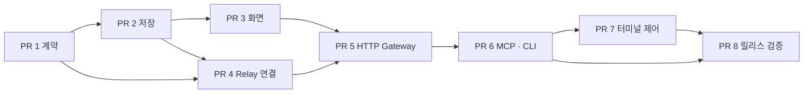

> Superseded: The user approved the reduced four-PR MCP plan on 2026-09-26. Active plan: `/Users/jr/Desktop/projects/deppy-sijo-cloud-agent-mcp/docs/superpowers/plans/2026-09-26-cloud-agent-mcp.md`. Do not implement the custom Gateway/offline queue below.

# Cloud Agent Session Bridge — PR별 개발 계획

> **For agentic workers:** 구현 요청을 받은 뒤 `execute-plan`을 사용해 PR 단위로 진행한다. 각 PR에서 관련 회귀 테스트, 코드 리뷰, 리뷰 반영, handoff 갱신을 완료한다. 앱 재실행은 해당 작업에서 사용자가 명시적으로 허락한 경우에만 수행한다.

**Goal:** 그록봇과 다른 클라우드 에이전트가 공통 HTTP/MCP 인터페이스로 지정된 Deppy 워크스페이스·세션에 결과를 보내고, 별도 권한을 받은 경우 그 세션의 터미널을 읽거나 입력할 수 있게 한다.

**Architecture:** 신뢰하는 Agent Gateway가 외부 HTTP/MCP 요청을 받고, 기존 Relay의 기기 측 암호화 연결을 통해 Mac으로 전달한다. Relay 데이터 평면은 계속 애플리케이션 암호문만 중계한다. Mac은 세션에 고정된 권한을 검증하고 결과를 영속화하며, 입력은 별도의 실행 중인 런타임 경로로 전달한다.

**Tech Stack:** 현재 Rust workspace, serde/serde_json, sync worker와 bounded channel, 기존 Relay P-256/AES-GCM API, SQLite, egui, HTTP/SSE 및 MCP Streamable HTTP. 새 의존성은 구현 착수 시 기존 lockfile과 라이선스·지원 버전을 확인해 고정한다. async 런타임을 제품에 새로 도입하지 않는다.

**Status:** 계획만 작성됨. 제품 구현, PR 생성, 테스트, 빌드, 배포, 앱 실행은 하지 않았다.

---

## 1. 목표와 사용자 흐름

### 1.1 첫 제공 범위

- 현재 워크스페이스와 세션에서 외부 에이전트를 연결한다.
- 기본 권한은 **결과 받기만**이다. 이 권한으로 화면·파일·다른 세션을 읽을 수 없다.
- 외부 결과는 현재 터미널과 같은 작업 영역의 **외부 결과** 영역에 스트리밍된다.
- 결과에는 에이전트 이름, 작업 상태, 수신 시각을 표시한다.
- 사용자가 다른 탭/워크스페이스로 이동해도 최초 연결 대상에 계속 도착한다.
- 다른 화면을 보고 있을 때는 원래 세션에 미확인 표시를 붙인다. 자동으로 포커스를 바꾸지 않는다.
- 앱 종료/재접속 뒤에도 저장된 결과가 남고, 전달이 중단된 결과는 마지막 확인 위치부터 이어 받는다.
- 그록봇 전용 프로토콜을 만들지 않는다. 같은 계약을 HTTP, MCP, CLI가 사용한다.

### 1.2 이후 제공 범위

- 해당 세션 화면 읽기.
- 단일 줄 텍스트 삽입.
- 텍스트와 Enter 전달.
- 별도 허용된 Ctrl+C 전달.
- 사용자가 외부 입력 제어를 회수하고 즉시 로컬 입력으로 돌아오기.

터미널 입력은 현재 실행 중인 셸 또는 CLI의 stdin으로 들어간다. 입력 수락은 셸 명령 성공이나 에이전트 작업 완료를 뜻하지 않는다.

### 1.3 워크스페이스와 화면

워크스페이스 구조는 유지한다. 그 아래 특정 세션에 외부 연결을 붙인다.

```text
deppy-sijo 워크스페이스
  ├─ 세션 A: 로컬 개발
  │    ├─ 기존 터미널
  │    └─ 외부 결과: Grok Bot / 다른 클라우드 에이전트
  └─ 세션 B: 다른 작업
```

연결 메뉴는 현재 세션의 더보기 메뉴에 둔다. 연결 모달에서 에이전트 이름, 대상 워크스페이스/세션, 권한, 만료 시간을 확인한다. 결과 영역에는 접기/펼치기, 복사, 마지막 메시지로 이동을 둔다. 권한 변경과 연결 해제는 동일한 연결 상세 화면에서 제공한다.

Claude/Codex의 전체 화면 TUI에 외부 문자열을 강제로 끼워 넣지 않는다. 결과는 Deppy가 소유하는 같은 pane의 결과 영역에서 표시한다. 따라서 TUI가 화면을 다시 그려도 결과가 사라지지 않는다. 일반 셸 stdout에 직접 출력하는 별도 helper 방식은 첫 제공 범위에 포함하지 않는다.

사용자는 평소의 로컬 세션을 유지하면서 외부 결과를 확인한다. 새 세션을 원하는 경우 기존 새 세션 기능으로 만들고 그 세션에 연결한다. 외부 결과를 받았다고 로컬 Claude/Codex의 내부 대화 맥락이 자동으로 공유되지는 않는다.

## 2. 현재 코드 근거와 재사용 경계

조사 기준: `feat/fleet-one-list-and-relay-wip`, HEAD `331b78b3`.

| 기존 위치 | 확인한 동작 | 계획에서의 활용 |
|---|---|---|
| `crates/web-remote/src/protocol.rs` | 영속 세션 UUID, Watch/Input/Key와 protocol v3 | 입력 의미와 식별 규칙 재사용; Agent protocol은 별도 버전 |
| `crates/web-remote/src/dashboard.rs` | 활성 워커의 UUID↔세션 매핑, watch 기반 입력, fire-and-forget | 입력 인코딩 재사용; Agent API의 대상 지정/확인은 별도 구현 |
| `crates/app/src/app.rs` | active/warm 런타임 식별과 workspace별 전달 경로 | 화면 전환 없는 런타임 대상 해결 |
| `crates/web-remote/src/relay/` | 기기 신원, E2EE, pairing, 저장소 경계 | 새 암호 구현 없이 그대로 호출 |
| `crates/web-remote/src/relay_client/` | Mac outbound WSS, 재연결, 권한 검증 | Agent 전용 명령 분기 추가 |
| `crates/app/src/relay_pairing.rs` | 모바일 pairing, 첫 릴리스 view-only | 모바일 권한 유지; Agent pairing에는 별도 grant |
| `crates/storage/src/db.rs` | forward-only migration, agent_work_turns | 결과 저장과 작업 이력 투영 |
| `crates/app/src/ui/work_history.rs` | 영속 작업 이력 카드, 유계 UI snapshot | 결과 완료 후 요약 투영; 원문은 별도 저장 |
| `crates/runtime/src/in_process.rs`, `crates/pty/src/input_queue.rs` | 입력 큐, backpressure, 수락/거절 | PR 7의 입력 중재와 확인 경로 |
| `crates/mcp/src/http.rs` | 외부 MCP 서버에 접속하는 클라이언트 | 전송 관례 참고; Deppy 제어 서버로 오인하지 않음 |
| `crates/mcp-proxy/src/main.rs` | 로컬 에이전트의 stdio 프록시 | 기존 역할 유지; 외부 MCP 서버는 Gateway가 제공 |

현재 Relay 릴리스 endpoint/shell origin 상수는 `None`이며 `deploy/relay/README.md`에는 배포 좌표 미결정이 기록되어 있다. 코드 개발은 로컬 fixture로 진행할 수 있으나, 실제 클라우드 연결 출시에는 도메인·TLS·자격증명 provisioning을 PR 8에서 확정해야 한다.

구현 시작 시 최신 통합 기준 커밋과 세션 격리 수정의 포함 여부를 확인한다. 이 계획의 조사 브랜치를 최신 실행 소스로 간주하지 않는다. migration 번호는 구현 기준 브랜치의 끝에 추가하며, 사용자 DB의 버전을 낮추거나 실제 DB로 migration 테스트하지 않는다.

## 3. 접근 방식 비교와 선택

| 방식 | 장점 | 제약 | 선택 |
|---|---|---|---|
| HTTP/MCP Gateway + 기존 Relay | 관리형 클라우드 도구와 공통 연동, 로컬 공개 포트 불필요 | Gateway가 데이터와 권한을 취급하는 신뢰 서비스가 됨 | 기본안 |
| 클라우드 CLI가 Relay E2EE에 직접 참여 | Gateway에 평문 전달을 줄일 수 있음 | 해당 클라우드 환경에서 설치·키 관리·CLI 실행이 가능해야 함 | 후속 확장 |
| 로컬 HTTP를 VPN/터널로 공개 | 소규모 실험이 간단함 | 클라우드의 네트워크 접근과 터널 설정에 의존함 | 개발용 fixture 외에는 기본안에서 제외 |

**신뢰 경계:** HTTP/MCP 클라이언트↔Gateway는 HTTPS 인증, Gateway↔Mac은 기존 Relay E2EE다. Gateway는 인증된 클라이언트에 허용된 데이터의 평문을 취급한다. 기존 ciphertext-only Relay가 평문을 취급한다는 설명으로 바꾸지 않는다. Gateway와 Relay는 별도 서비스·자격증명·배포 단위다.

## 4. 공통 계약

아래 이름은 새로 구현할 계약이다. 현재 공개 API가 아니다.

### 4.1 대상과 권한

`AgentBinding`은 다음을 영속화한다.

- `binding_id`, `principal_id`: opaque UUID.
- `device_id`: Gateway의 이 연결에 대한 Relay 기기 신원.
- `workspace_id`, `session_uuid`: 사용자 선택 후 고정되는 영속 대상.
- `binding_revision`: 재지정/권한 변경/회수 시 증가하는 정수.
- `scopes`, `issued_at`, `expires_at`, `revoked_at`.

다른 대상에 연결하려면 새 binding을 만든다. 기존 bearer를 다른 세션으로 옮기지 않는다. runtime-local u64는 네트워크에 노출하지 않는다. read/input에는 추가로 현재 `runtime_instance`와 세션 생명주기 stamp를 확인하고, input에는 짧은 writer lease를 요구한다. 결과 수신은 runtime이 없어도 영속 대상에 저장 가능하다.

| Scope | 허용 | 경계 |
|---|---|---|
| `result.publish` | 작업 상태/결과 이벤트 보내기 | 화면·파일 읽기와 입력 권한 없음 |
| `session.read` | 지정 세션의 유계 화면 snapshot 읽기 | 다른 세션 목록·승인·파일·공유 스크롤 상태 변경 없음 |
| `terminal.insert` | 단일 줄 텍스트 삽입 | CR/LF/ESC와 제어문자 거절, Enter 없음 |
| `terminal.submit` | 텍스트+Enter 전달 | lease와 현재 runtime stamp 필수 |
| `terminal.interrupt` | Ctrl+C 전달 | 임의 키·Ctrl+D·승인 결정은 없음 |

`terminal.insert`에서 CR/LF를 허용하면 기존 입력 인코더가 실행 가능한 Enter로 바꿀 수 있으므로 삽입 전용 요청은 반드시 거절한다. 결과 이벤트는 ANSI/OSC 제어 시퀀스로 해석하지 않고 텍스트로 표시한다.

**초기 제한:** binding 24시간 기본 만료, 최대 7일; pairing ticket 5분·1회; Mac당 활성 binding 32개; 한 binding당 동시 작업 8개. 권한 확대/연장에는 사용자의 로컬 변경이 필요하다. Bearer는 32바이트 무작위 값으로 1회 표시하고 서버에는 digest만 저장한다. 토큰은 URL/query, 로그, 오류 응답에 넣지 않는다.

Mac은 매 명령에서 현재 grant를 확인한다. Gateway의 주장만으로 인가하지 않는다. 모바일 view-only 기기는 Agent 명령을 사용할 수 없다. Agent 결과 전용 기기에 전체 Dashboard/Viewport/승인 목록을 자동 발행하지 않는다.

### 4.2 결과 이벤트

`ResultEvent`는 `binding_id`, `job_id`, `event_id`, `sequence`, `kind`, `text`를 가진다. `kind`는 `started`, `delta`, `completed`, `failed`, `cancelled` 중 하나다. 수신 시각은 Mac이 기록하고 외부 시각은 표시용 metadata로만 쓴다.

```json
{
  "v": 1,
  "type": "result_event",
  "request_id": "4cf36673-6bb9-4a68-a63a-4cfeb0024d12",
  "binding_id": "913057d4-15df-4b81-844a-b082a5a31369",
  "binding_revision": 1,
  "job_id": "743316c4-81d9-498d-883c-9f962e46a3ac",
  "event_id": "6634506d-3764-48dc-9a16-a920370543ed",
  "sequence": 2,
  "kind": "delta",
  "text": "검토 결과를 전달합니다."
}
```

- `started`는 sequence 1, 이후 마지막 확정 sequence+1만 새 이벤트로 수락한다.
- 동일 event_id/sequence와 동일 payload 재전송은 동일 receipt를 반환한다.
- 동일 식별자에 다른 payload는 `event_conflict`, 순서가 비면 `sequence_gap`과 기대 sequence를 반환한다.
- terminal kind 뒤의 새 이벤트는 `job_finished`로 거절한다.
- Mac의 이벤트 저장과 receipt/cursor 갱신은 같은 DB transaction이다. commit 이후만 `persisted` ACK를 보낸다.
- Gateway가 디스크에 받은 상태 `queued`와 Mac에 저장된 상태 `persisted`를 구분한다. `displayed`는 성공 조건으로 쓰지 않는다.
- 새 연결에서 transport 암호 sequence는 초기화되지만 application event sequence는 이어진다. 새 SecureChannel로 재암호화하고 예전 ciphertext를 재사용하지 않는다.

**초기 용량:** 요청 본문 64 KiB, text 16 KiB/event, 1 MiB/job 및 4,096 events/job. Gateway 미전달 보관은 binding당 8 MiB·최대 24시간, 전역 256 MiB. 완료 작업의 로컬 보관은 기본 30일·전역 256 MiB; 활성 작업은 용량 초과 시 명시적 오류를 반환하고 조용히 자르지 않는다. 만료/용량 초과는 durable tombstone과 receipt에 남기며 재전송으로 다시 생성하지 않는다.

### 4.3 입력과 재시도

입력 요청에는 `request_id`, binding revision, runtime stamp, `lease_id`가 필수다. 최초 전달 전에 로컬 입력 receipt를 `dispatching`으로 기록한다. runtime은 동일 요청을 한 번만 enqueue하며 실제 수락/거절을 request_id로 되돌려 준다.

PTY 효과와 DB 기록은 원자적으로 묶을 수 없다. crash/ACK 유실 뒤 실행 여부를 확인할 수 없으면 `unknown`으로 남기고 자동 재전송하지 않는다. 새 request_id 발급도 사용자 또는 호출자의 명시적인 재시도 결정이어야 한다. 입력 `accepted`는 명령의 exit code가 아니다.

Mac/Gateway가 오프라인이면 입력은 저장 후 실행하지 않고 `target_offline`으로 거절한다. 결과 이벤트만 유계 대기열에 저장한다.

## 5. PR 목록과 의존성

| PR | 제안 브랜치 | 범위 | 의존성 | 사용자에게 제공되는 결과 |
|---|---|---|---|---|
| 1 | `feat/cloud-agent-contract` | 대상·권한·명령 계약과 binding 저장 | 기준 브랜치 확인 | 공통 권한/세션 기준 확정 |
| 2 | `feat/cloud-agent-result-store` | 결과 inbox, receipt, 복원, 보관 정책 | 1 | 중복 없는 영속 결과 저장 |
| 3 | `feat/cloud-agent-result-ui` | 같은 작업 화면 결과 영역·미확인 표시·이력 | 2 | 로컬 fixture로 표시 흐름 검증 |
| 4 | `feat/cloud-agent-relay-peer` | Gateway 기기 측 client와 Mac Agent adapter | 1, 2 | 암호화 경로로 결과 전달 |
| 5 | `feat/cloud-agent-http-gateway` | HTTPS API·pairing·토큰·offline queue·화면 읽기 | 3, 4 | HTTP로 실제 연결/결과 수신 |
| 6 | `feat/cloud-agent-mcp-cli` | MCP façade·CLI·호환성 안내 | 5 | 여러 클라우드 에이전트의 공통 연결 |
| 7 | `feat/cloud-agent-terminal-control` | 터미널 삽입/Enter/Ctrl+C·writer lease | 6 | 선택적으로 기존 터미널 제어 |
| 8 | `test/cloud-agent-release` | 통합 회귀·재연결·배포 구성·운영 문서 | 6; 제어 출시에는 7 | 검증된 결과 수신/제어 릴리스 |



결과 수신 기능은 PR 1~6과 PR 8의 결과 수신 게이트로 출시 가능하다. PR 7을 생략해도 결과 수신이 작동해야 한다. 실제 진행은 순차 리뷰를 기본으로 하며, 이 계획은 병렬 에이전트 실행을 요청하지 않는다.

## 6. PR별 작업과 완료 기준

### PR 1 — 계약·세션 고정·권한 저장

**Files**

- Create: `crates/agent-bridge-contract/{Cargo.toml,src/lib.rs,src/target.rs,src/grant.rs,src/message.rs,src/limits.rs}`.
- Create: `crates/app/src/cloud_agent/{mod.rs,bindings.rs,repository.rs}`.
- Modify: `Cargo.toml`, `Cargo.lock`, `crates/app/Cargo.toml`, `crates/storage/src/db.rs`, `crates/app/src/main.rs`, `crates/app/src/app.rs`.
- Tests: contract module tests, `crates/storage/tests/cloud_agent_bindings.rs`.

**Tasks**

- [ ] 기준 브랜치를 확인하고 최신 통합 코드의 persistent session UUID와 migration 마지막 항목을 대조한다.
- [ ] 타입과 JSON fixtures를 정의하고 잘못된 UUID/revision/크기/권한 조합의 거절 테스트를 먼저 작성한다.
- [ ] binding/grant 저장을 forward-only migration으로 추가한다. 기존 Relay 기기 권한 컬럼을 확대해 모바일 입력을 열지 않는다.
- [ ] 기기 신원과 grant 결합, grant 회수/revision 갱신, 삭제 대상 tombstone을 구현한다. API token digest는 PR 5 Gateway가 소유한다.
- [ ] 재시작해도 binding이 같은 workspace/session을 가리키는지 실제 임시 SQLite DB로 검증한다.

**Acceptance:** 권한 없는 명령·다른 세션 지정·만료·회수·예전 revision이 부수효과 이전에 거절된다. 아직 외부 listener나 UI 기능을 열지 않는다.

**Run:** `cargo test -p agent-bridge-contract -p storage --locked`.

### PR 2 — 영속 결과 inbox·receipt·복원

**Files**

- Create: `crates/app/src/cloud_agent/{results.rs,result_worker.rs,projection.rs}`.
- Create: `crates/storage/tests/cloud_agent_results.rs`.
- Modify: `crates/storage/src/{db.rs,write_worker.rs}`, `crates/app/src/cloud_agent/{mod.rs,repository.rs}`.

**Tasks**

- [ ] 중복 event, 내용 충돌, 순서 누락, terminal 후 delta, DB reopen 테스트를 먼저 작성한다.
- [ ] 결과/job/cursor/receipt 저장과 commit 후 ACK를 구현한다. snapshot 생성은 유계 worker에서 처리한다.
- [ ] inactive/suspended workspace 결과도 저장하고, 닫힌 세션에는 이력으로 남긴다. 삭제된 대상은 거절하며 다른 세션으로 대체하지 않는다.
- [ ] session 연결은 중단되어도 결과 작업은 계속될 수 있다. terminal worker가 없다는 이유로 result를 버리지 않는다.
- [ ] 보관 기한·전역 예산·tombstone 정리를 구현한다. `agent_work_turns`의 8 KiB 메시지 요약은 원문 저장으로 쓰지 않는다.
- [ ] 완료 결과를 기존 work history에 요약으로 투영하되 local native agent session ID와 섞지 않는다.

**Acceptance:** commit 직전/직후 crash를 흉내 낸 fixture에서 결과 누락·중복이 없다. 앱 메모리를 새로 생성하고 DB를 reopen해 결과가 복원된다. 테스트가 실제 사용자 DB를 열지 않는다.

**Run:** `cargo test -p storage --locked --test cloud_agent_results`; `cargo test -p deppy-sijo --locked --bin deppy-sijo cloud_agent::`.

### PR 3 — 같은 세션의 결과 UI

**Files**

- Create: `crates/app/src/ui/cloud_agent/{mod.rs,results.rs,connection.rs}`.
- Modify: `crates/app/src/ui/{mod.rs,workspace.rs,agent_terminal.rs,work_history.rs}`, `crates/app/src/cloud_agent/projection.rs`, `crates/app/src/app.rs`.
- Modify: `crates/i18n/locales/{ko-KR,en-US,ja-JP,zh-Hans,zh-Hant}/messages.txt`.
- Create: `crates/app/tests/cloud_agent_ui.rs`.

**Tasks**

- [ ] 세션 A에 수신한 결과가 세션 B 화면에 표시되지 않는 projection 테스트를 먼저 작성한다.
- [ ] 기존 pane 안에 접을 수 있는 외부 결과 영역과 작업 상태·agent 출처·복사를 구현한다.
- [ ] 사용자가 과거 메시지를 읽는 중이면 자동 스크롤하지 않고 새 결과 표시를 제공한다.
- [ ] 비활성 세션 미확인 표시와 사용자가 직접 누르는 결과로 이동 동작을 추가한다.
- [ ] 결과는 텍스트/선택 가능한 코드 표시로 렌더하고 ANSI·OSC·HTML을 실행하지 않는다.
- [ ] 기존 work history의 카드 구성과 타이포그래피를 재사용한다. 새로운 full-screen terminal renderer를 만들지 않는다.
- [ ] 연결 UI의 로컬 grant 편집 상태를 구현한다. 실제 연결 시작 버튼은 PR 5 wiring이 있기 전 feature gate로 숨긴다.

**Acceptance:** TUI 모드 전환/화면 갱신과 결과 표시가 독립적이다. 새 이벤트가 대상 pane의 결과 영역만 갱신하고 키보드 포커스·선택·현재 탭을 바꾸지 않는다. fixture 기반 egui 검증을 사용하며 실행 중인 Deppy를 재실행하지 않는다.

**Run:** `cargo test -p deppy-sijo --locked --test cloud_agent_ui`; `cargo test -p i18n --locked`.

### PR 4 — 암호화 Relay 경로와 Gateway 기기 client

**Files**

- Create: `crates/agent-bridge-client/{Cargo.toml,src/lib.rs,src/pairing.rs,src/channel.rs,src/reconnect.rs}`.
- Create: `crates/web-remote/src/relay_client/agent_adapter.rs`.
- Create: `crates/agent-bridge-client/tests/relay_peer.rs`.
- Modify: `Cargo.toml`, `Cargo.lock`, `crates/web-remote/src/relay_client/{mod.rs,handshake.rs,worker.rs}`, `crates/app/src/{relay_pairing.rs,relay_repository.rs,app.rs}`, `crates/app/src/cloud_agent/{bindings.rs,mod.rs}`.
- Modify only for tests: `crates/relay-server/tests/transport_contract.rs`.

**Tasks**

- [ ] Gateway의 기기 role로 pairing/known-device reconnect/Mac key pin을 검증하는 fixture를 먼저 작성한다.
- [ ] client는 기존 공개 `web_remote::relay` crypto API와 Relay frame contract를 호출한다. 새 암호 알고리즘·키 유도·sequence 구현을 복제하지 않는다.
- [ ] 기기 측 handshake 상태기계를 구현하고 기존 pairing의 사용자가 대조하는 코드로 Gateway를 승인한다.
- [ ] Agent principal을 binding과 결합하고 복호화 후 Agent 전용 명령 adapter로 분기한다. peer가 스스로 principal kind를 선언한 것만으로 승인하지 않는다.
- [ ] mobile/browser ClientMsg와 Agent protocol을 인증된 principal 유형에 따라 구분한다. 잘못된 유형의 프레임은 거절한다.
- [ ] `result.publish` 명령을 PR 2 inbox에 연결한다. 기기 회수/권한 축소는 살아 있는 채널에도 반영한다.
- [ ] 재연결은 capped backoff+jitter, generation fence, bounded queue를 사용한다. 암호 채널과 application ACK의 수명주기를 구분한다.

**Acceptance:** Relay 서버 전체 traffic fixture에 결과 원문·session UUID가 나타나지 않는다. 잘못된 Mac fingerprint/재생/위조 프레임이 거절된다. 결과 전용 principal에 Dashboard/Viewport가 발행되지 않는다. 기존 view-only 모바일 회귀가 유지된다.

**Run:** `cargo test -p agent-bridge-client -p web-remote -p relay-protocol -p relay-server --locked`.

### PR 5 — HTTPS Gateway·연결 모달·결과 queue·읽기

**Files**

- Create: `crates/agent-gateway/{Cargo.toml,src/lib.rs,src/main.rs,src/http.rs,src/auth.rs,src/enrollment.rs,src/store.rs,src/delivery.rs,src/read.rs}`.
- Create: `crates/agent-gateway/tests/{http_contract.rs,offline_delivery.rs,enrollment.rs}`.
- Create: `crates/app/src/cloud_agent/target_router.rs`.
- Modify: `Cargo.toml`, `Cargo.lock`, `crates/app/src/cloud_agent/{mod.rs,bindings.rs,repository.rs}`, `crates/app/src/ui/cloud_agent/connection.rs`, `crates/app/src/app.rs`, `crates/web-remote/src/relay_client/agent_adapter.rs`.

**Proposed routes**

| Endpoint | 기능 | 권한/조건 |
|---|---|---|
| `POST /v1/enrollments` | 일회성 연결 ticket로 pairing 시작 | TLS, 5분·1회 ticket; 완료 전 session data 없음 |
| `GET /v1/enrollments/{id}` | 자기 enrollment 진행 확인 | 별도 단기 enrollment 자격증명 |
| `GET /v1/connection` | 자기 연결 이름·만료·허용 기능 | 해당 binding bearer |
| `POST /v1/jobs/{job_id}/events` | 결과 이벤트 전송 | `result.publish` |
| `GET /v1/jobs/{job_id}` | 자기 job의 전달 receipt/cursor 확인 | 같은 binding; 원문 반환은 별도 `session.read` 필요 |
| `GET /v1/session/snapshot` | 지정 세션 snapshot | `session.read`; online active/warm만 live |
| `GET /v1/events` | receipt/연결 상태 SSE | binding 범위, replay cursor·bounded stream |

**Tasks**

- [ ] 허용되지 않은 binding 접근, token 유출, quota, admission expiry 테스트를 먼저 작성한다.
- [ ] HTTPS edge 뒤 별도 Gateway를 구성한다. routing handle과 client bearer를 서로 대체 가능한 자격증명으로 쓰지 않는다.
- [ ] PR 3 모달→일회성 ticket→Gateway 등록→코드 대조→Mac grant 승인→API token 발급을 연결한다. 승인 commit 전에는 token이 활성화되지 않는다.
- [ ] Gateway identity는 binding마다 분리한다. private key/복구 키는 Gateway 운영 secret 경로에서만 관리한다. 상태 DB의 민감 payload는 secret 경로의 저장 키로 암호화한다.
- [ ] Gateway result queue를 영속화하고 bounded retry를 구현한다. disconnect 때마다 DB 미확인 이벤트를 새 암호 채널에 재전송한다.
- [ ] Mac ACK 후만 `persisted`를 표시한다. Gateway 재시작, Mac 오프라인, quota 초과, grant expiry 상태를 클라이언트에 구분한다.
- [ ] token 회수와 Mac grant 회수를 연결한다. 오프라인 중 수신된 결과는 재접속 시 현재 grant를 다시 확인하고 회수된 요청은 폐기 receipt를 남긴다.
- [ ] 별도 target router가 workspace/session UUID를 active/warm runtime으로 해결한다. 기존 Dashboard active sink를 바꿔 끼우거나 Switch를 보내지 않는다.
- [ ] suspended workspace 읽기는 `target_suspended`, 종료 세션 읽기는 `session_closed`로 반환한다. 저장 결과는 UI에서 계속 볼 수 있다. 별도 자동 wake는 없다.
- [ ] snapshot은 최대 64 KiB/1,000줄로 제한하고 truncation·capture time·runtime stamp를 표시한다. 다른 세션 목록/파일 경로/승인 정보는 자동 반환하지 않는다.

**Acceptance:** curl fixture 하나로 생성한 결과가 선택된 세션에 저장된다. Mac이 끊긴 동안 `queued`인 결과가 재접속 후 한 번 표시된다. Gateway가 재시작해도 미전달 결과가 보존된다. 결과 전용 연결로 화면 읽기가 거절된다.

**Run:** `cargo test -p agent-gateway -p agent-bridge-client --locked`; `cargo test -p deppy-sijo --locked --bin deppy-sijo cloud_agent::`.

### PR 6 — 공통 MCP 도구·CLI·호환성 안내

**Files**

- Create: `crates/agent-gateway/src/mcp/{mod.rs,lifecycle.rs,tools.rs}`.
- Create: `crates/agent-gateway/tests/mcp_contract.rs`.
- Create: `crates/agent-bridge-cli/{Cargo.toml,src/main.rs,src/client.rs}`.
- Create: `docs/cloud-agent-bridge.md`, `examples/cloud-agent/{publish-result.sh,grok-remote-mcp.py}`.
- Modify: `Cargo.toml`, `Cargo.lock`, `crates/agent-gateway/src/{lib.rs,http.rs}`, `crates/app/src/ui/cloud_agent/connection.rs`.

**Proposed MCP tools**

- `deppy_connection_info`: 자기 binding과 허용 기능만 확인.
- `deppy_publish_result`: PR 5 result event와 동일 검증/receipt.
- `deppy_result_status`: 해당 job 전달 상태 확인.
- `deppy_read_session`: 허용된 세션 snapshot.

PR 7에서는 `deppy_acquire_input`, `deppy_insert_text`, `deppy_submit_text`, `deppy_interrupt`, `deppy_release_input`을 추가한다. tool 목록에서도 권한에 따라 숨기지만 실제 호출 검증은 항상 수행한다.

**Tasks**

- [ ] MCP initialize/version negotiation/tools/list/tools/call, expiry, unknown tool 테스트를 작성한다.
- [ ] `/mcp` Streamable HTTP를 구현한다. JSON-RPC request id/MCP session id와 Deppy binding id를 혼용하지 않는다.
- [ ] bearer를 보낼 수 있는 클라이언트부터 지원하고 HTTP API와 동일 서비스 함수를 호출한다. 도구별 별도 권한 로직을 복제하지 않는다.
- [ ] 인증 SSE와 bounded response 처리, timeout, 클라이언트 disconnect cleanup을 구현한다.
- [ ] CLI는 `connection`, `publish`, `status`, `read`를 제공하고 token은 환경/secret 파일로 읽는다. 토큰이 process argv에 들어가는 옵션은 제공하지 않는다.
- [ ] 에이전트가 job output/파일/파이프를 delta event로 전송할 수 있는 예제를 제공한다. 작업 결과 자동 수집은 해당 에이전트 측 adapter의 책임임을 명시한다.
- [ ] MCP 지원 에이전트는 MCP, cloud shell 지원 에이전트는 CLI/HTTP를 안내한다. 전용 플랫폼 UI를 억지로 자동 조작하는 기능은 포함하지 않는다.
- [ ] 그록봇 제품의 실제 connector/CLI 설정과 Grok API Remote MCP 지원을 별도로 기록한다. 실제 제품 연결을 확인하지 않은 상태는 `문서 확인`으로 표시하고 `호환 검증 완료`로 쓰지 않는다.

**Acceptance:** HTTP·MCP·CLI가 동일 권한/오류/중복 receipt를 반환한다. xAI Remote MCP용 example과 generic cloud-shell publish fixture가 같은 결과 경로를 사용한다. provider가 임의 MCP/HTTP/CLI 사용을 허용하지 않으면 그 제한을 안내하며 범용 호환을 보장하지 않는다.

**Run:** `cargo test -p agent-gateway --locked --test mcp_contract`; `cargo test -p agent-bridge-cli --locked`.

### PR 7 — 선택적 터미널 제어·입력 중재

**Files**

- Create: `crates/app/src/cloud_agent/control.rs`.
- Create: `crates/runtime/src/input_arbiter.rs`.
- Create: `crates/agent-gateway/src/input.rs`.
- Create: `crates/app/tests/cloud_agent_session_isolation.rs`.
- Modify: `crates/runtime/src/{lib.rs,command.rs,event.rs,in_process.rs,protocol.rs}`, `crates/pty/src/input_queue.rs`.
- Modify: `crates/app/src/{app.rs,cloud_agent/target_router.rs,ui/cloud_agent/connection.rs,ui/workspace.rs}`.
- Modify: `crates/web-remote/src/relay_client/agent_adapter.rs`, `crates/agent-gateway/src/{http.rs,mcp/tools.rs}`, `crates/agent-bridge-cli/src/{main.rs,client.rs}`, `crates/storage/src/db.rs`.

**Tasks**

- [ ] 동일 workspace의 두 session, 탭 전환, UUID 재사용 시도, 오래된 runtime stamp, lease 만료 테스트를 먼저 작성한다.
- [ ] HTTP/MCP/CLI에 lease 취득·해제, insert, submit, interrupt를 추가한다. PR 1의 각각의 scope를 검증한다.
- [ ] writer lease는 최대 30초, heartbeat로 갱신하며 Mac 재시작/세션 교체 시 재취득해야 한다.
- [ ] target router는 명령 직전에 runtime_instance와 session 생명주기 stamp를 재검증한다. suspended/exited 대상에는 명령을 보내지 않는다.
- [ ] 기존 입력 인코딩/PTY queue를 재사용하되 Agent 요청에는 operation ID와 runtime ACK를 붙인다. 기존 fire-and-forget `send_input` 호출만으로 완료 처리하지 않는다.
- [ ] 단일 runtime input arbiter에서 로컬 키보드·붙여넣기·앱의 기존 자동 입력·web 입력·Agent 입력을 중재한다. 로컬 입력 요청은 외부 lease를 회수하고 미전달 외부 요청을 취소한다.
- [ ] runtime이 PTY enqueue 직전에 lease generation을 다시 검사한다. grant 회수/로컬 takeover는 아직 쓰지 않은 외부 입력 batch를 취소한다. 이미 PTY에 쓴 바이트를 회수했다고 표시하지 않는다.
- [ ] 외부 submit의 본문과 Enter는 하나의 논리적 입력 작업으로 전달한다. CR/LF/제어 문자와 scope 검사를 우회하는 named key 경로를 열지 않는다.
- [ ] input request id 중복 처리와 crash 후 unknown receipt를 구현한다. 불명확한 입력은 자동 재시도하지 않는다.
- [ ] UI에 입력 제어 중인 agent 이름과 입력 제어 회수 버튼을 표시한다. grant 확대는 로컬 사용자 조작으로만 한다.

**Acceptance:** 세션 A로 보낸 명령은 같은 workspace의 B나 현재 포커스 세션으로 전달되지 않는다. 로컬 입력과 외부 입력 바이트가 섞이지 않는다. grant 회수 후 대기 입력이 실행되지 않는다. queue full/ACK 유실이 실행 성공으로 표시되지 않는다. 입력 권한 없이 결과 보내기는 계속 가능하다.

**Run:** `cargo test -p runtime -p pty --locked`; `cargo test -p deppy-sijo --locked --test cloud_agent_session_isolation`; `cargo test -p agent-gateway --locked`.

### PR 8 — 통합 검증·릴리스 구성·문서

**Files**

- Create: `crates/agent-gateway/tests/end_to_end.rs`.
- Create: `deploy/agent-gateway/{README.md,gateway.env.example,agent-gateway.service}`.
- Create: `scripts/verify-cloud-agent-bridge.sh`.
- Modify: `deploy/relay/README.md`, `docs/cloud-agent-bridge.md`, `docs/CODEX_HANDOFF.md`, 실제 앱/서버 빌드 워크플로우.
- Modify when deployment coordinates are supplied: `crates/web-remote/src/relay_client/{lifecycle.rs,link.rs}`.

**Tasks**

- [ ] fixture 환경의 HTTP/MCP client→Gateway→실제 로컬 Relay server→Mac adapter→임시 DB→UI snapshot 시나리오를 구성한다.
- [ ] app 상태 reopen, Gateway 재시작, socket reset, ACK 유실, 동일 event 재전송, token expiry/revoke, quota와 slow consumer를 검증한다.
- [ ] 입력 릴리스에는 두 세션 격리/로컬 takeover/unknown 재시도 방지/오프라인 거절 시나리오를 추가한다.
- [ ] 기존 모바일 view-only/Tailscale/로컬 터미널 입력과 공존 회귀를 수행한다.
- [ ] staging의 정확한 Gateway/Relay/shell host, DNS, TLS edge, provisioning 주체, 운영 secret 이름, 상태 volume/backup, 회수 절차를 배포 문서에 확정한다. 임의 도메인·기본 credential을 넣지 않는다.
- [ ] Gateway는 plaintext를 다루는 신뢰 endpoint이고 Relay는 ciphertext-only라는 배포 경계를 검증한다. 로그는 토큰/메시지/터미널 본문을 남기지 않는다.
- [ ] Grok Bot, Grok API, generic MCP client, cloud-shell CLI의 실제 검증 상태를 각각 기록한다. 사용 가능한 제품별 연결 한 가지를 실제 확인해야 해당 제품 지원으로 표시한다.
- [ ] 최종 전체 diff 코드 리뷰→수정→필요한 테스트 재실행→앱과 proxy 재빌드 순서로 마무리한다.
- [ ] 실제 Deppy 실행/재실행이 필요한 화면 확인은 사용자 허락이 있는 별도 작업에서 수행한다. 미수행이면 결과 보고에 명시한다.

**Acceptance:** 외부 결과가 지정한 세션에 이어 표시되고 재접속/상태 복원 후에도 보존된다. 출시 권한 범위와 제품별 검증 결과가 문서와 일치한다. 외부 공개 endpoint가 준비되지 않았으면 로컬 검증 완료와 실제 서비스 제공 가능 상태를 구분한다.

**Run (implementation-time gates, not executed for this plan):**

```bash
cargo test -p agent-gateway --locked --test end_to_end
cargo test --workspace --locked
cargo clippy --workspace --locked --all-targets -- -D warnings
cargo fmt --all -- --check
git diff --check
cargo build -p deppy-sijo -p mcp-proxy --locked
cargo build -p agent-gateway -p agent-bridge-cli --release --locked
```

사용자 앱을 실행하는 `scripts/dev-run.sh`는 위 검증 명령에 포함하지 않는다. 배포 패키지 서명/공증은 release 절차와 실제 자격증명이 준비된 경우 수행한다. 이 계획 작성 단계에서는 빌드하지 않는다.

## 7. 모든 PR의 공통 마무리

- [ ] PR에 포함하는 파일/이슈 범위를 하나의 기능 경계로 유지한다.
- [ ] 관련 검증을 실행하고 실제 명령·결과를 기록한다. RED/GREEN이 필요한 계약 변경은 해당 증거를 보관한다.
- [ ] 최종 diff를 코드 리뷰하고 발견한 문제를 반영한다. 테스트를 늘리는 경우 구체적인 남은 위험 또는 필요한 gate를 근거로 한다.
- [ ] `docs/CODEX_HANDOFF.md`에 목표, 완료, 변경 파일, 설계 결정, 테스트, 실패 접근, 잔여 작업, 다음 명령을 갱신한다.
- [ ] 제품 구현 요청의 전달 범위에 따라 commit/push/PR을 진행한다. 이 계획 작성은 GitHub PR 생성이나 서버 배포를 수행하지 않는다.
- [ ] 앱은 재빌드까지만 하고 재실행하지 않는다. 해당 작업의 명시적인 재실행 요청이 있을 때만 실행한다.

## 8. 개발 착수 시 첫 명령

```bash
cd /Users/jr/Desktop/projects/deppy-sijo
git status --short --branch
git log -5 --oneline
git worktree list
sed -n '1,100p' AGENTS.md
sed -n '1,85p' docs/CODEX_HANDOFF.md
cat docs/superpowers/plans/2026-09-26-cloud-agent-session-bridge.md
```

그 뒤 사용할 최신 통합 기준 커밋과 적용 AGENTS.md를 확인하고 PR 1 전용 worktree를 만든다. 실제 사용자 데이터나 실행 중인 앱을 변경하는 작업으로 시작하지 않는다.

## 9. 공식 호환성 근거

- [xAI Remote MCP](https://docs.x.ai/developers/tools/remote-mcp): Grok API의 remote HTTP/SSE MCP, authorization header, allowed tools. API 지원을 Grok Bot 제품의 사용자 지정 connector 지원과 동일시하지 않는다.
- [Grok Bot computer and apps](https://docs.x.ai/grok-bot/computer-and-apps): Bot의 cloud computer/terminal과 사용자의 로컬 컴퓨터는 별개다. 허용된 로컬 컴퓨터 기능이 기존 Deppy PTY 연결을 자동으로 제공한다는 근거는 아니다.
- [MCP transports](https://modelcontextprotocol.io/specification/2025-11-25/basic/transports): Streamable HTTP의 lifecycle/content negotiation/SSE. 구현 시작 시 실제 제공 버전과 클라이언트의 negotiation 범위를 다시 확인한다.

## 10. 계획 자체 검토와 현재 검증

- 사용자 요구인 결과 수신/터미널 입력을 각각 PR 1~6/PR 7에 배정했다.
- 다른 탭 입력, active-only bridge의 오사용, 결과 소실, 입력 재실행을 계약/저장/중재 테스트로 배정했다.
- pairing, 클라우드 접근, HTTPS endpoint, 기기 암호화 client를 누락 없이 PR 4~5/8에 배정했다.
- HTTP와 MCP의 인가·delivery 코드를 공유하고 기존 Relay/PTY 구현을 재사용한다.
- 계획 검증은 문서 diff와 참조 경로/PR 의존성 점검만 수행한다. 제품 테스트와 실제 provider 호환성은 구현 후 검증한다.
- 실제 문서 점검: `git diff --check` exit 0. PR 1~8 순서, 기존 참조 경로 15개 존재, 새 문서 trailing whitespace 없음과 핵심 계약 문구를 확인한 스크립트 exit 0. Cargo 테스트/빌드와 실제 provider 연결 검증은 수행하지 않았다.
